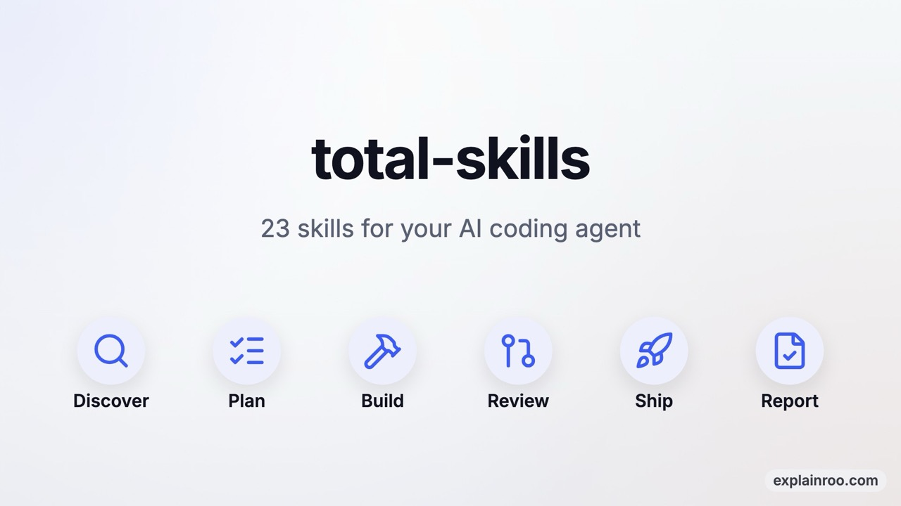
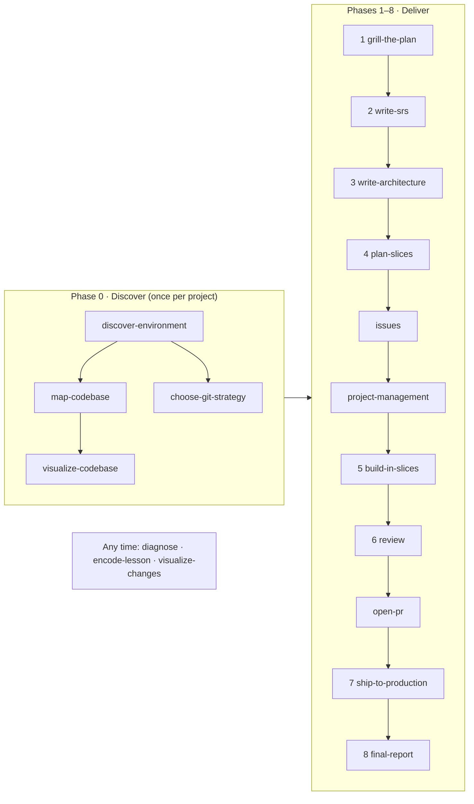
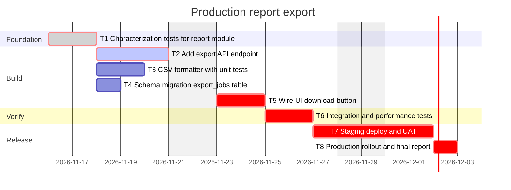
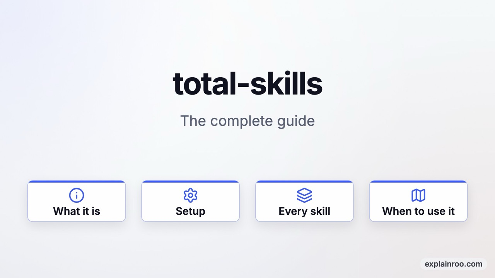

# total-skills

**A skill pack that gives your AI coding agent a complete, reviewable engineering process: discover → requirements → architecture → plan → build → review → ship → report.**

23 skills, a git safety hook, and two zero-dependency visual tools (a change map and a Gantt chart). It works in Claude Code as a plugin. The skills are plain Markdown, so Cursor, Codex and other agents can read them too.

<!-- VIDEO:SHORT -->
**▶ Two-minute overview**

[](https://github.com/buwaneka-halpage/total-skills/releases/tag/videos-v1)
<!-- /VIDEO:SHORT -->

---

## Contents

- [Why use it](#why-use-it)
- [Install](#install)
- [Set up for your team](#set-up-for-your-team)
- [How it works](#how-it-works)
- [The skills, phase by phase](#the-skills-phase-by-phase)
- [Project management and Gantt charts](#project-management-and-gantt-charts)
- [Scenarios: which path to take](#scenarios-which-path-to-take)
- [When to use it, and when not to](#when-to-use-it-and-when-not-to)
- [Tools you can run without an agent](#tools-you-can-run-without-an-agent)
- [Limits and known gaps](#limits-and-known-gaps)
- [Full video guide](#full-video-guide)
- [Extending the pack](#extending-the-pack)

---

## Why use it

AI coding agents are fast, but left alone they skip steps. They start coding before requirements are clear, forget how your team works, and push, post or deploy before anyone has looked. total-skills fixes that by giving the agent a process to follow, while every decision stays with you.

| Advantage | What it means in practice |
|---|---|
| **Consistency** | Every project follows the same lifecycle, and every phase writes the same kind of document. |
| **Traceability** | Requirements get IDs (`FR-1`, `NFR-1`, `REG-1`). Tasks, commits, tests and the final report all trace back to them. A requirement with no evidence is marked **NOT VERIFIED**, never left out. |
| **Safety** | Issues, PRs, comments and board changes are **drafted first** and posted only after you approve. A git guard blocks force pushes, hard resets, direct pushes to protected branches and PR merges. Production changes need your go-ahead per command. |
| **Visibility** | Diagrams first, then text: codebase maps, change maps (treemap and blast radius), and Gantt charts with the critical path. |
| **Works on legacy code** | Characterization tests before any change, "must not change" regression requirements, and seams instead of rewrites. |
| **Light on context** | Only the skill descriptions are always loaded (about 1,900 tokens). A skill's full instructions load only when it runs. |
| **Owned by your team** | It's plain files in git. Review changes to the process like code, and add a rule each time you learn something (`encode-lesson`). |

---

## Install

You need [Claude Code](https://docs.claude.com/en/docs/claude-code), plus `git` and Python 3 for the scripts. Install once per computer and every project can use it:

```bash
claude plugin marketplace add buwaneka-halpage/total-skills
claude plugin install total-skills@total-skills --scope user
```

Start a new Claude Code session; the skills and the git guard load at session start. Check the install with:

```bash
claude plugin details total-skills@total-skills
```

**Other ways to install**

| Option | Command | Use when |
|---|---|---|
| One session only | `claude --plugin-dir /path/to/total-skills` | trying it out |
| One repo, shared with its team | copy `skills/*` into the repo's `.claude/skills/` | the team wants the skills versioned in the repo (the hook and scripts need the plugin install) |
| Other agents (Cursor, Codex…) | point the agent's rules or instructions at `skills/*/SKILL.md` | the hook won't run, but the skills still apply |

**Update:** `claude plugin marketplace update total-skills`, then restart the session.

---

## Set up for your team

1. **Fill in [`context/TEAM.md`](context/TEAM.md).** Every skill reads it, and the agent follows it *literally*, so keep it short and factual:
   - **Stack:** languages, frameworks, repos, key internal services
   - **Environments:** what the agent may run where (for example, *never write to the prod DB*)
   - **Verify commands:** what must pass before every commit (`make lint`, `make test`…)
   - **Collaboration:** draft-first posting, branch naming, commit format, where specs live
   - **Review checklist:** team-specific checks (authz on every endpoint, no PII in logs…)
   - **Release process:** approvals, deploy windows, rollout method, signals to watch
   - **Hard rules:** secrets, approved plugins, compliance constraints
2. **In each project, start with** *"run discover-environment"*. It writes `docs/environment.md` (stack, infra, cloud, CI/CD, project tool) with evidence for every fact.
3. **For GitHub Projects boards**, grant the extra permission once: `gh auth refresh -s project`.

---

## How it works

### The lifecycle



Each phase leaves a real file in your repository, and each one feeds the next:

| File | Written by | Used by |
|---|---|---|
| `docs/environment.md` | `discover-environment` | every other skill |
| `docs/codebase-map.md`, `docs/visual/codebase.html` | `map-codebase`, `visualize-codebase` | SRS, SAD, onboarding |
| `docs/git-strategy.md` | `choose-git-strategy` | `git-workflow` |
| `docs/<feature>/SRS.md` | `write-srs` | SAD, plan, tests, review, report |
| `docs/<feature>/SAD.md` | `write-architecture` | plan, review |
| `docs/<feature>/PLAN.md`, `gantt.html`, `gantt.md` | `plan-slices`, `project-management` | issues, board, status reports |
| `drafts/…` | `issues`, `open-pr`, `address-pr-comments` | you, before anything is posted |
| `docs/<feature>/REPORT.md` | `final-report` | handover, `encode-lesson` |

### The router

You don't need to remember the skills. **`using-total-skills`** reads your request and picks the lightest path that fits: a new feature gets the whole lifecycle, while a small change or a bug fix takes a shorter route (see [Scenarios](#scenarios-which-path-to-take)). You can also name a skill directly: *"run map-codebase"*.

### Eight rules the agent always follows

1. **State assumptions** before non-trivial work.
2. **Stop on contradictions** between SRS, SAD, code and ticket, and ask.
3. **Look facts up** in the code, config and `docs/environment.md`, and ask you only for decisions.
4. **Prove it:** "done" means a test or command that ran, with its output.
5. **Show, don't tell:** diagrams and change maps before walls of text.
6. **Draft first** for anything outward-facing.
7. **Stay in scope:** note unrelated problems, but don't fix them in the same change.
8. **Production is different:** it always goes through `ship-to-production`.

### Draft-first

Issues, PRs, review replies and project-board changes are written to `drafts/` and shown to you. Nothing goes to GitHub, Jira or anywhere else until you approve that draft.

### The git guard

`hooks/git-guard.py` runs before every shell command the agent issues and blocks:

| Blocked | Why |
|---|---|
| `git push --force` / `-f` (`--force-with-lease` is allowed) | rewrites shared history |
| `git reset --hard`, `git clean -f`, `git checkout -- .`, `git restore .` | discards work |
| `git branch -D` | deletes unmerged work |
| direct `git push` to `main`, `master`, `develop`, `dev`, `release/*` | open a PR instead |
| `gh pr merge` | merging needs your explicit approval |
| changing branch protection with `gh api` | |

Branch names are matched whole, so `dev-tools`, `maintenance-fix` and `feat/dev` are not blocked. A bare `git push` (no branch named) can't be checked. Edit `PROTECTED` in the hook to match your branches.

---

## The skills, phase by phase

### Phase 0: Discover (once per project)

| Skill | What it does | Output |
|---|---|---|
| `discover-environment` | Read-only inventory of the stack, dependencies, infrastructure, cloud, CI/CD, source control, environments and project tool. Every fact cites its evidence file; anything unconfirmed is marked *(unverified)*. Never installs, deploys or logs in. Afterwards you can just ask: *"which database do we use?"* | `docs/environment.md` |
| `map-codebase` | Runs the build and tests, maps modules and outside systems, test coverage, hotspots (from git history), conventions and hazards (hidden cron jobs, global state, magic config). Changes nothing. | `docs/codebase-map.md` |
| `visualize-codebase` | One HTML page: system context, module map coloured by test coverage, 2–3 key request flows, data model, hotspot treemap, and a "read these 7 files first" tour. | `docs/visual/codebase.html` |
| `choose-git-strategy` | Existing repo: reads the history to show what the team *really* does (merge style, branch lifetimes, tags, protection). New project: decides from the requirements. Shows 2–4 options (trunk-based, GitHub Flow, release branches, GitFlow) with diagrams and records your choice. | `docs/git-strategy.md` |

### Phases 1–3: Requirements and design

| Skill | What it does | Output |
|---|---|---|
| `grill-the-plan` | Interviews you in rounds. Questions are numbered, each with a recommended answer, so you can reply "1 yes, 2 yes". It always covers who uses it, what done looks like, what must not break, data and security, how it reaches production and how it's rolled back. | agreed decisions |
| `write-srs` | Requirements spec. Every requirement has an ID and a checkable acceptance criterion ("p95 < 300 ms", not "fast"). For existing systems, the **Must not change** section (`REG-*`) is mandatory. | `docs/<feature>/SRS.md` |
| `write-architecture` | Context, proposed design, interfaces, data and migrations (expand → migrate → contract), cross-cutting concerns, decisions with the options weighed, and a requirement → component map. In existing code it extends current patterns and finds the *seams*. | `docs/<feature>/SAD.md` |

### Phase 4: Plan

| Skill | What it does | Output |
|---|---|---|
| `plan-slices` | Breaks the design into **vertical slices**: thin end-to-end paths, not "all the DB, then all the API". Each task lists the requirements it satisfies, the test that proves it, its dependencies, size, phase, estimate in working days and owner. Riskiest slice first. | `docs/<feature>/PLAN.md` |
| `issues` | One GitHub issue per task with acceptance criteria and blocked-by links. Drafted first, posted in dependency order, numbers written back into the plan. Also triages issues. | GitHub issues |
| `project-management` | Gantt chart, project board and status tracking. See [below](#project-management-and-gantt-charts). | `gantt.html`, `gantt.md`, board |

### Phase 5: Build

| Skill | What it does |
|---|---|
| `build-in-slices` | Test-first loop per task: **red** (a failing test named after the requirement), **green** (least code), **clean** (refactor), **verify** (TEAM.md commands), **commit**. Legacy code gets characterization tests first, then the smallest seam in its own commit. Never mixes refactoring with behaviour change; never weakens a test to get green. |
| `git-workflow` | Branch from an up-to-date base with the issue number in the name, one logical change per commit (`type(scope): subject` + `Refs #123`), sync daily, worktrees for parallel work. When done it offers exactly three options: open a PR, keep the branch, or discard. |
| `diagnose` | Builds a fast, repeatable failing loop first, ranks 2–3 hypotheses and tests the cheapest, fixes the root cause rather than the symptom, and keeps the reproducing test as a regression test. Redacts secrets and personal data. |

### Phase 6: Review

| Skill | What it does |
|---|---|
| `review` | Reviews the diff against the SRS, SAD and plan, not just the code, on seven axes: requirements, design, correctness, tests, security, operability, simplicity, plus your TEAM.md checklist. Findings come as `[blocker|major|minor|nit] file:line: problem → fix`. |
| `visualize-changes` | A change map for any range: a treemap with changed files coloured, a blast-radius list of files that import them, a commit timeline, and for large changes a guided "change story" with before/after diagrams. |
| `open-pr` | Drafts the PR: why, what changed, evidence before and after, blast radius, rollback, and a reviewer guide. Opening a PR never means merging it. |
| `address-pr-comments` | Verifies every review comment against the code, then classifies it: **fix**, **dismiss** (with concrete evidence) or **ask** you. Replies are drafted and posted after approval. |
| `resolve-conflicts` | Works out which side is "ours" (it flips during a rebase), reads why each side changed, combines mechanical edits, stops on incompatible intent, and isn't done until the tests pass. |

### Phases 7–8: Ship and close

| Skill | What it does |
|---|---|
| `ship-to-production` | Pre-flight checklist (review passed, CI green on the exact commit, rollback path, backward-compatible migrations, signals, approvals), then the lowest environment first, gradual rollout, and *roll back first, investigate second*. |
| `ci-cd` | Checks whether CI/CD is in scope (`none`, `existing-dont-touch`, `existing-extend`, `create-new`). Reads failed logs and fixes code; never skips or weakens a check. New pipelines pin actions, use least-privilege permissions and OIDC. |
| `final-report` | Traceability matrix (requirement → code → test → evidence), regression results, deviations, test summary, **planned vs actual Gantt**, release details and lessons. |
| `encode-lesson` | Turns a mistake into a lasting fix, preferring the strongest place: a test, lint rule or CI check, then a TEAM.md rule, then a line in a skill. |

---

## Project management and Gantt charts

```
plan-slices → issues (drafted first) → project-management → Gantt chart + project board
                                              ↓
              "where are we?" → current Gantt vs baseline, slipped tasks, blockers
                                              ↓
                                final-report → planned vs actual schedule
```

`scripts/gantt.py` schedules every task after its dependencies, skips weekends, and computes the **critical path**: the tasks where any delay moves the end date. It reads:

- a **plan file** (`PLAN.md` from `plan-slices`),
- a **GitHub Project** (live start and target dates), or
- **JSON** exported from any other tool.

It writes two outputs: an **interactive HTML chart** (phases, dependency arrows, critical path, status colours, today line, hover details, light and dark mode, works on a phone), and a **Mermaid gantt block** that GitHub renders natively in issues, PRs and Markdown. Example from [`examples/PLAN.example.md`](examples/PLAN.example.md):



**Supported tools.** GitHub Projects is the default. The skill also has adapters for **Jira, Azure Boards, Linear, Asana and Notion**, and a CSV route for **MS Project, Smartsheet, monday.com and Excel**. `discover-environment` detects which one a project uses (from links, issue keys like `ABC-123` or `AB#123`, and connected tools) and records it.

**Tracking.** Ask *"where are we?"* and the agent pulls the current state, draws the Gantt against the approved baseline (`gantt-baseline.md`), lists slipped tasks with their critical-path impact and blockers, and proposes a re-plan. **It never moves dates, owners or scope to hide a slip.**

---

## Scenarios: which path to take

| Situation | Say something like | Path |
|---|---|---|
| **New project or repo you don't know** | "run discover-environment" | `discover-environment` → `map-codebase` → `visualize-codebase` → `choose-git-strategy` |
| **New feature** (bigger than a day) | "I want CSV export for reports, grill me" | `grill-the-plan` → `write-srs` → `write-architecture` → `plan-slices` → `issues` → `project-management` → `build-in-slices` → `review` → `open-pr` → `ship-to-production` → `final-report` |
| **Small change** | "rename the `total` field to `amount`" | `git-workflow` → `build-in-slices` → `review` → `open-pr` |
| **Bug** | "exports fail for names with commas" | `diagnose` → `review` → `open-pr` → `encode-lesson` if it could recur |
| **Legacy code with no tests** | "change how invoices round" | `map-codebase` → characterization tests (`build-in-slices`) → SRS with `REG-*` items → small slices |
| **"What changed?" / big PR** | "show me what changed since yesterday" | `visualize-changes` |
| **Status report** | "where are we?" | `project-management` (Gantt vs baseline, slips, blockers) |
| **PR feedback** | "address the comments on #57" | `address-pr-comments` |
| **Merge or rebase conflicts** | "resolve the conflicts" | `resolve-conflicts` |
| **CI is red** | "CI is failing on my branch" | `ci-cd` (→ `diagnose` if it's a real bug) |
| **Release** | "ship it to staging" | `ship-to-production` (→ `ci-cd` if pipelines are in scope) |
| **Same mistake twice** | "you did this again" | `encode-lesson` |
| **Quick question about the project** | "which cloud are we on?" | `discover-environment` (query mode, cites the line) |

---

## When to use it, and when not to

**Use the full lifecycle when:**
- the work is bigger than about a day, or touches several layers;
- other people will review, maintain or depend on it;
- it changes existing behaviour that users rely on (legacy code especially);
- it will reach production, or needs a schedule and status reporting.

**Use a short path when:**
- it's a small, contained change: `git-workflow` → `build-in-slices` → `review` → `open-pr`;
- it's a bug: start with `diagnose`.

**Skip the documents when:**
- it's a one-line fix or a throwaway prototype, where the documents cost more than they save. The router already scales documents to the change, and you can always say *"skip the spec"*.

---

## Tools you can run without an agent

Both scripts use only the Python standard library.

```bash
# What changed in a branch or range: treemap, blast radius, timeline, per-file diffs
python3 scripts/change-map.py --repo /path/to/project --base origin/main --head HEAD --out changes.html
# Where change concentrates: files sized by size, coloured by churn
python3 scripts/change-map.py --repo /path/to/project --hotspots --since "1 year ago" --out hotspots.html

# Gantt chart from a plan, a GitHub Project, or JSON
python3 scripts/gantt.py --plan docs/<feature>/PLAN.md --start 2026-12-01 --out gantt.html --mermaid gantt.md
python3 scripts/gantt.py --github-project <owner> <project-number> --out status.html
python3 scripts/gantt.py --json tasks.json --out gantt.html
```

In a plan, `--start` applies only to tasks without a fixed `Start:` date. Every other task is scheduled after its dependencies.

---

## Limits and known gaps

- **GitHub Projects** needs the `project` permission (`gh auth refresh -s project`). Organisations may also need to allow it.
- **Jira, Azure Boards, Linear, Asana, Notion and CSV adapters** are written from each tool's documentation and haven't been tested against real accounts yet.
- **`context/TEAM.md` ships with TODOs.** Fill it in before relying on verify commands, review checklists or release rules.
- **The git guard** can't see which branch a bare `git push` targets, and it only runs where the plugin's hooks run (Claude Code).
- **One TEAM.md per install.** If you work across several organisations, keep TEAM.md general and put project specifics in each repo's `docs/environment.md`.

---

## Full video guide

<!-- VIDEO:GUIDE -->
**▶ The complete guide (about 14 minutes)**

[](https://github.com/buwaneka-halpage/total-skills/releases/tag/videos-v1)
<!-- /VIDEO:GUIDE -->

| Time | Chapter | Covers |
|---|---|---|
| 0:00 | What total-skills is | the problem, skills, lifecycle, documents, the router, the eight rules |
| 1:44 | Install and set up | plugin install, TEAM.md, git guard, draft-first |
| 2:47 | Phase zero: discover | discover-environment, query mode, map-codebase, visualize-codebase, choose-git-strategy |
| 4:19 | Requirements and design | grill-the-plan, write-srs, regression items, write-architecture, seams |
| 5:44 | Plan and track | vertical slices, task fields, issues, Gantt chart, PM tools, tracking |
| 7:22 | Build | test-first loop, legacy code, house rules, git-workflow, diagnose |
| 8:43 | Review and pull requests | review, visualize-changes, open-pr, address-pr-comments, resolve-conflicts |
| 10:01 | Ship and close | ship-to-production, ci-cd, final-report, encode-lesson |
| 11:06 | Scenarios | new feature, small change, bug, legacy project, status, and more |
| 12:25 | Why use it | advantages, when to skip, limits |
| 13:34 | Get started | first steps |

Both videos are also downloadable, with subtitles, from the [videos release](https://github.com/buwaneka-halpage/total-skills/releases/tag/videos-v1). They were made with [explainroo](https://www.explainroo.com/).

---

## Extending the pack

- **Add a skill:** create `skills/<name>/SKILL.md` with `name` and `description` frontmatter. The description says **when** to use it, because that's what the agent sees before loading it. Keep it under about 80 lines and put long tables in `references/`.
- **Change the process:** edit the skill, open a PR, and review it like code.
- **After a mistake:** run `encode-lesson`. It proposes the smallest durable fix.

### Repository layout

```
.claude-plugin/   plugin.json, marketplace.json
skills/           23 skills, each a SKILL.md (+ references/)
hooks/            git-guard.py (PreToolUse) and hooks.json
scripts/          change-map.py, gantt.py (Python stdlib only)
context/TEAM.md   your team's rules (fill this in)
examples/         sample PLAN.md and Gantt outputs
docs/media/       video cover images
```
